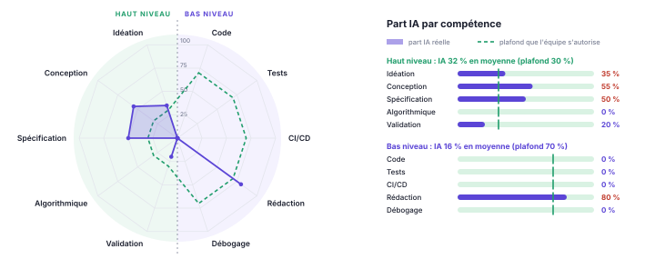

<!--
  Dossier de projet : 4 pages pour le dossier de lancement (R1), puis il s'enrichit à chaque livraison.
  Compilation : make -C doc   (pandoc + WeasyPrint ; mise en page dans style.css)
  Les commentaires HTML comme celui-ci n'apparaissent pas dans le PDF.
-->

# Équipe, comptes développeurs et dépôt

| Membre | Compte GitHub | Email des commits (`git config user.email`) |
|----------------------------|------------------------------|-----------------------------------------|
| Hajar JELTHI | [`@Hajar-JLT23`](https://github.com/Hajar-JLT23) | `[email-git-de-Hajar]` |
| Rayane KACHBI | [`@Rayanekachbi`](https://github.com/Rayanekachbi) | `kachbirayane27@gmail.com` |

**Dépôt** : <https://github.com/Rayanekachbi/menuswipe> · **page de projet** : <https://rayanekachbi.github.io/menuswipe/>.

Chaque membre a vérifié que son email Git est associé à son compte GitHub pour que ses commits lui soient bien attribués. L'équipe compte actuellement deux étudiants ; sa composition reste à régulariser conformément à l'effectif demandé (3 à 5 personnes). Les membres C et D du plan sont prévus à cet effet.

Chaque étudiant porte une feature complète, sans répartition en silos front/back. Une branche et une PR sont prévues par feature, avec relecture croisée par un autre membre.

# Projet et caractère innovant

**Problème et public.** MenuSwipe s'adresse aux étudiants et actifs souhaitant organiser leurs repas selon leurs goûts, leur budget et les ingrédients disponibles. Le besoin retenu est de coordonner les recettes de la semaine afin de limiter les achats et les restes de conditionnements entamés.

**Proposition.** L'utilisateur découvre des recettes sous forme de cartes qu'il apprécie ou rejette. L'application adapte les suggestions et calcule un menu sous contraintes. Un « j'aime » actualise les préférences ; seul l'ajout confirmé au menu réserve des ingrédients.

**Entité pivot : le menu hebdomadaire.** Ses recettes alimentent les calculs de quantités, de substitutions, de courses et de préparation. Les recommandations tiennent compte des ingrédients déjà mobilisés : une recette pourra être favorisée parce qu'elle réutilise un reste prévu par un autre repas du menu.

**Différenciation recherchée.** Le projet associe découverte personnalisée et planification globale explicable. Il calcule des sélections, affectations et ordonnancements plutôt que de seulement enregistrer des recettes. Une comparaison avec les solutions existantes reste à réaliser ; aucune nouveauté absolue n'est revendiquée.

L'objectif est de réduire les restes estimés, sans garantir zéro gaspillage. Les prix, recettes et plans de magasin seront des données de démonstration, sans connexion commerciale en temps réel.

# Scénarios d'usage

1. **F1 — Découverte.** En tant qu'utilisateur, j'apprécie ou rejette des recettes afin d'obtenir des suggestions adaptées à mes goûts et au menu en cours.
2. **F2 — Composition.** En tant qu'étudiant, je renseigne mon budget, mon stock et le nombre de repas afin d'obtenir un menu limitant les achats et les restes.
3. **F3 — Substitution.** En tant qu'utilisateur, je demande un remplacement d'ingrédient afin d'adapter une recette à mes disponibilités.
4. **F4 — Préparation.** En tant qu'utilisateur, je renseigne mes équipements afin de préparer plusieurs plats avec un planning sans conflits de ressources.
5. **F5 — Calendrier.** En tant qu'utilisateur, je renseigne les dates limites afin de placer les repas dans des créneaux compatibles.
6. **F6 — Courses.** En tant qu'utilisateur, je consulte une liste ordonnée selon un magasin de démonstration afin de réduire mes déplacements entre les rayons.

# Plan des features

Chaque feature traverse **BD, back, API REST et front**, avec une migration Flyway, un algorithme métier, des endpoints et un scénario démontrable. Elle est portée par **une seule personne**.

Le socle comporte **2 × 3 = 6 features**. Les colonnes C et D portent le total à 9 ou 12 uniquement si l'équipe s'agrandit. Les attributions et variantes algorithmiques sont prévisionnelles.

| Version | Hajar JELTHI | Rayane KACHBI | Membre C éventuel | Membre D éventuel |
|-----|---------|---------|---------|---------|
| **v0.1.0** 24/11 | **F1** Flux adaptatif — *LinUCB* | **F2** Menu sous budget — *branch-and-bound* | **F7** Formats d'achat — *programmation dynamique* | **F10** Menu collectif — *recherche exhaustive bornée max-min* |
| **v0.2.0** 08/12 | **F3** Substitutions — *filtrage métier et similarité cosinus* | **F4** Batch cooking — *ordonnancement par liste sous contraintes de ressources* | **F8** Diversité — *recherche locale par échanges* | **F11** Répartition des tâches — *algorithme hongrois* |
| **v1.0.0** 19/01 | **F5** Calendrier — *flot à coût minimal* | **F6** Parcours — *Dijkstra, plus proche voisin et 2-opt* | **F9** Réparation du menu — *recherche à voisinage limité* | **F12** Comparaison de menus — *filtrage de Pareto* |

**Cadrage.** F2 sélectionne les recettes en tenant compte des paquets entiers à acheter ; F7 choisit les conditionnements pour des besoins déjà fixés. F3 utilise des profils culinaires et des règles de remplacement : la co-occurrence seule ne suffit pas. F4 ordonne les opérations ; F5 affecte les repas aux jours admissibles. F11 concerne des tâches indépendantes sur des créneaux fixés.

Les recherches combinatoires seront bornées. Les heuristiques ne garantissent pas l'optimalité. Complexités, alternatives, cas limites et invariants seront justifiés dans les fiches. Chaque extension restera rattachée au menu commun.

# Architecture

**Front → API REST → cas d'utilisation et domaine → persistance → BD.**

| Couche | Choix | Remarques |
|--|-----|-----|
| Front | HTML, CSS, JavaScript natif | `front/` ; client REST uniquement |
| API REST | Spring Boot 4 / MVC, OpenAPI / Swagger UI | `/api/v1`, erreurs RFC 9457 `problem+json` |
| Back | Java 21, Spring Boot 4, JPA, Bean Validation | Architecture hexagonale |
| BD | PostgreSQL 17 ; H2 pour les tests | Flyway ; une migration par feature |
| Qualité | JUnit 5, AssertJ, ArchUnit, JaCoCo, Codecov, SonarCloud | CI GitHub Actions |
| Conteneurs | Docker Compose | BD dès v0.1.0 ; application en v0.2.0 |

**Architecture hexagonale.** Chaque module distingue `domain` en Java pur, `application` avec ports et services sans Spring, `adapter` pour REST/JPA et `config` pour l'assemblage. Les dépendances pointent vers le domaine ; les modules communiquent par leurs ports. ArchUnit vérifie ces règles.

**Modèle commun.** Menu, repas, recettes, ingrédients et quantités constituent le socle partagé. Stocks, conditionnements, prix indicatifs et unités normalisées permettent les calculs. Le coût porte sur les paquets entiers ; les restes sont évalués par ingrédient. Les dates sont renseignées, sans inférence de sécurité alimentaire.

**Démonstration.** Le profil `demo` chargera quelques dizaines d'entrées via un script SQL répétable et idempotent dans `src/main/resources/db/demo/`. Les comportements seront démontrables en un lancement.

**Qualité du code.** Noms métier explicites, fonctions ciblées, absence de duplication, principes SOLID, objets valeur immuables et invariants à la construction. Les patterns seront justifiés : Strategy pour les variantes, Adapter pour les interfaces. Validation des entrées, échappement des sorties, requêtes paramétrées et secrets hors dépôt appliqueront les précautions OWASP. Le quality gate SonarCloud devra être vert.

**Livraison.** La CI exécutera build, tests, couverture et compilation documentaire. Les tags `v*` déclencheront la release du JAR et du PDF ; `site/` alimentera GitHub Pages. La compatibilité PostgreSQL sera vérifiée en complément des tests H2.

# Démarche pour chaque feature

Les étapes sont suivies **dans l'ordre**, après validation de la précédente.

| Étape | Ce qu'on fait | Terminé quand |
|--|--------|-----|
| **1. Idéation** | Besoin, scénario, algorithme, complexité, alternatives, impacts BD/API et critères ; issue et fiche `doc/features/`. | Fiche validée par un autre membre. |
| **2. Back** | Migration Flyway, domaine Java pur, ports, services, persistance et assemblage. | Compilation et ArchUnit réussis. |
| **3. Tests** | Cas nominaux, limites, invariants et propriétés à graine fixe ; faux adaptateurs ; intégration de persistance. | `./gradlew build` passe ; chaque critère est couvert. |
| **4. API REST** | Endpoints, DTO validés, erreurs `problem+json`, OpenAPI et tests API. | Swagger UI disponible ; tests API verts. |
| **5. Front** | Écrans consommant uniquement l'API REST. | Scénario complet vérifié ; PR relue ; fiche et araignée complétées. |

# Protocole d'usage de l'IA

**Principe : l'IA assiste, l'humain reste l'auteur.** Chaque étudiant doit comprendre, expliquer et modifier ses contributions. Le cœur des algorithmes est écrit par les étudiants. L'assistance progresse étape par étape, avec vérification de compréhension. Les règles retenues sont versionnées dans `CLAUDE.md`.

| Activité | IA | Humain |
|---|-----|-----|
| Idéation et conception | Critique et propose des options | Choisit, justifie et valide la fiche |
| Algorithme | Explique, relit après une tentative | Conçoit et écrit le cœur |
| Code technique | Propose un premier jet | Relit, adapte et vérifie |
| Tests | Suggère des cas | Définit les propriétés ; vérifie la détection des défauts |
| CI/CD et conteneurs | Propose workflows et Dockerfile | Comprend, exécute et gère les secrets |
| Documentation | Structure et reformule | Vérifie les faits et valide |

**Interdits.** Commiter du code non compris ; transmettre des secrets ou données personnelles ; utiliser une autre identité ; présenter comme humain un travail de l'IA.

**Traçabilité.** Chaque PR indique l'outil, les demandes et les éléments repris, modifiés ou rejetés. Le graphe `doc/part-ia.json` distingue cinq axes de haut niveau — idéation, conception, spécification, algorithmique, validation — et cinq de bas niveau — code, tests, CI/CD, rédaction, débogage.

Les plafonds fixés par l'équipe sont de **30 % par axe de haut niveau** et **70 % par axe de bas niveau**. Ils sont distincts des contributions réelles, mesurées si pertinent, estimées et expliquées sinon. Tout dépassement est déclaré.

# Annexe : part IA / part humaine {#annexe-part-ia}

{.araignee}

Les valeurs sont renseignées dans `doc/part-ia.json` et le graphique est régénéré à chaque compilation.

**État du R1.** L'idée initiale (détourner les algorithmes de recommandation des réseaux sociaux vers un besoin concret) vient de l'équipe. Les assistants IA (ChatGPT / Gemini) ont contribué au choix du domaine culinaire anti-gaspillage, au cadrage des douze algorithmes prévisionnels et à la rédaction initiale de ce dossier, qui a ensuite été relu, ajusté et validé par l'équipe. GitHub Copilot (mode agent) a lancé le script d'initialisation du dépôt et reporté ce texte dans `doc/dossier.md`. Aucun code applicatif ni algorithme n'étant livré au stade R1, les axes techniques et algorithmiques sont à 0 %.

**Dépassements déclarés.** Idéation (35 %), conception (55 %), spécification (50 %) et rédaction (80 %) dépassent leurs plafonds, car les assistants ont structuré le plan des features et rédigé la première version du dossier.
