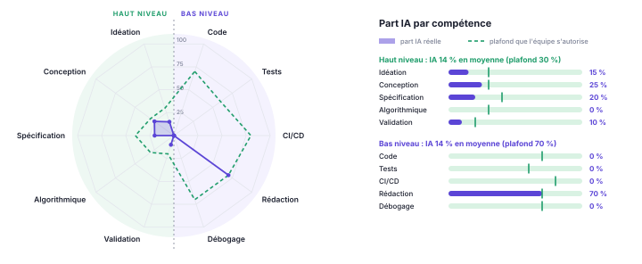

<!--
Dossier de lancement du projet (R1).
Ce document constitue un état initial du projet. Il sera enrichi et corrigé
au fil des itérations et des livraisons. Les choix techniques et fonctionnels
qui ne sont pas encore implémentés restent prévisionnels et pourront évoluer.
Compilation : make -C doc
-->

**# Équipe, comptes développeurs et dépôt**

L'équipe est actuellement composée de deux membres. Chaque membre prend en charge ses fonctionnalités de bout en bout, de la conception à l'interface utilisateur. Les pull requests font l'objet d'une relecture croisée.

| Membre | Compte GitHub | Email des commits |
|---|---|---|
| Hajar JELTHI | [@Hajar-JLT2](https://github.com/Hajar-JLT2) | jelthihajar@gmail.com |
| Rayane KACHBI | [@Rayanekachbi](https://github.com/Rayanekachbi) | kachbirayane27@gmail.com |

Les adresses indiquées correspondent aux emails utilisés pour les commits. L'association de chaque adresse à son compte GitHub devra être vérifiée par les membres.

- **Dépôt GitHub :** https://github.com/Rayanekachbi/menuswipe
- **Page du projet :** https://rayanekachbi.github.io/menuswipe/

La composition de l'équipe est celle retenue à ce stade. Toute évolution éventuelle sera répercutée dans le document.

**# Projet et caractère innovant**

**Problème et public visé.** MenuSwipe s'adresse principalement aux étudiants et aux actifs qui souhaitent organiser leurs repas en tenant compte de leurs goûts, de leur budget et des ingrédients dont ils disposent. Préparer les repas d'une semaine implique plusieurs décisions liées : choisir des recettes, vérifier les ingrédients disponibles, estimer les achats nécessaires et organiser la préparation.

Le projet cherche à faciliter ces décisions et à limiter les achats inutiles ainsi que les restes alimentaires. Il ne vise toutefois pas à garantir une absence totale de gaspillage.

**Proposition.** MenuSwipe proposera une découverte de recettes sous forme de cartes que l'utilisateur pourra apprécier ou rejeter. Ces réactions auront vocation à faire évoluer les recommandations. L'utilisateur pourra ensuite composer un menu hebdomadaire en tenant compte de contraintes telles que le budget, les stocks et le nombre de repas souhaités.

Un « j'aime » exprimera une préférence, sans réserver automatiquement les ingrédients. La réservation des quantités sera associée à l'ajout confirmé d'un repas au menu.

**Entité pivot : le menu hebdomadaire.** Le menu constitue le point de convergence des fonctionnalités envisagées. Les recettes qui le composent serviront de base aux calculs de quantités, aux substitutions d'ingrédients, à l'organisation des préparations et à la liste de courses. Une recette pourra notamment être favorisée parce qu'elle réutilise un ingrédient déjà nécessaire à un autre repas.

**Caractère innovant recherché.** L'intérêt du projet réside dans l'association entre découverte personnalisée et planification globale. MenuSwipe ne doit pas seulement enregistrer des recettes ou afficher des listes : l'application a vocation à calculer des recommandations, des sélections de repas, des affectations et des ordonnancements à partir de contraintes explicites.

La comparaison détaillée avec les solutions existantes reste à réaliser. À ce stade, l'équipe ne revendique donc pas une nouveauté absolue, mais cherche à proposer une combinaison cohérente de fonctionnalités autour du menu hebdomadaire.

Les recettes, prix et plans de magasin utilisés pour les démonstrations seront des données de test ou de démonstration. Aucune connexion à un catalogue commercial ou à des prix de magasins en temps réel n'est prévue dans le périmètre initial.

**# Scénarios d'usage**

Les scénarios suivants décrivent les usages visés. Ils correspondent aux fonctionnalités prévues et ne signifient pas que celles-ci sont déjà disponibles.

1. **F1 — Découverte de recettes.** En tant qu'utilisateur, je souhaite apprécier ou rejeter des recettes afin d'obtenir progressivement un flux de suggestions adapté à mes goûts et à mon menu.

2. **F2 — Composition du menu.** En tant qu'étudiant disposant d'un budget limité, je souhaite renseigner mon budget, mes ingrédients disponibles et le nombre de repas à prévoir afin d'obtenir une proposition de menu limitant les achats et les restes.

3. **F3 — Substitution d'ingrédients.** En tant qu'utilisateur, je souhaite demander le remplacement d'un ingrédient afin d'adapter une recette à mes disponibilités ou à mes préférences, tout en conservant une proposition cohérente avec le contexte culinaire.

4. **F4 — Organisation des préparations.** En tant qu'utilisateur, je souhaite renseigner les équipements dont je dispose afin d'obtenir un ordre de préparation tenant compte des dépendances entre opérations et des éventuels conflits de ressources.

5. **F5 — Calendrier des repas.** En tant qu'utilisateur, je souhaite renseigner les dates et contraintes associées à mes repas afin de les répartir dans des créneaux compatibles.

6. **F6 — Parcours de courses.** En tant qu'utilisateur, je souhaite obtenir une liste de courses organisée selon un plan de magasin de démonstration afin de faciliter mon parcours et de limiter les déplacements inutiles.

**# Plan des features**

Le développement est organisé autour de six fonctionnalités majeures réparties sur trois itérations prévisionnelles. Avec deux membres, le plan actuel prévoit une fonctionnalité par membre et par itération.

Chaque fonctionnalité doit traverser les quatre dimensions du projet : base de données, back-end, API REST et front-end. Elle devra également comporter une migration Flyway, un traitement métier reposant sur un algorithme identifié, des endpoints et un scénario démontrable.

Chaque membre réalise ses fonctionnalités de bout en bout. Les choix de conception et les pull requests font l'objet d'une relecture croisée.

Les affectations et les dates ci-dessous constituent une première planification. Elles pourront être ajustées selon l'avancement, les difficultés techniques et les éventuelles consignes de l'équipe enseignante.

| Version prévisionnelle | Hajar JELTHI | Rayane KACHBI |
|---|---|---|
| **v0.1.0** — 24 novembre | **F1 — Flux adaptatif de recettes.** Algorithme envisagé : LinUCB. | **F2 — Composition du menu sous budget.** Algorithme envisagé : branch-and-bound. |
| **v0.2.0** — 8 décembre | **F3 — Substitution d'ingrédients.** Approche envisagée : filtrage métier et classement par similarité cosinus. | **F4 — Organisation du batch cooking.** Algorithme envisagé : ordonnancement par liste sous contraintes de ressources. |
| **v1.0.0** — 19 janvier | **F5 — Calendrier des repas.** Algorithme envisagé : flot à coût minimal. | **F6 — Parcours de courses.** Approches envisagées : Dijkstra, plus proche voisin et amélioration 2-opt. |

**Périmètre fonctionnel prévisionnel**

- **F1 — Découverte :** proposer des recettes en tenant compte des réactions de l'utilisateur et du menu en cours. Le choix de LinUCB devra être précisé et évalué dans la fiche de fonctionnalité.
- **F2 — Composition :** sélectionner des repas sous une contrainte de budget en intégrant les stocks disponibles, les conditionnements et les restes estimés.
- **F3 — Substitution :** filtrer les remplacements incompatibles, puis classer les propositions restantes selon leur proximité culinaire. La substitution devra être confirmée par l'utilisateur et ses conséquences sur les quantités et le menu devront être prises en compte.
- **F4 — Préparation :** ordonner les opérations de préparation selon leurs dépendances et les équipements disponibles.
- **F5 — Calendrier :** affecter les repas à des créneaux admissibles en tenant compte des dates et des coûts de placement retenus.
- **F6 — Courses :** construire puis améliorer un parcours de courses à partir d'un plan de magasin de démonstration et des ingrédients nécessaires au menu.

**Cohérence entre les fonctionnalités**

Les fonctionnalités doivent s'appuyer sur un modèle métier commun, organisé autour du menu hebdomadaire, des repas, des recettes, des ingrédients et des quantités. Les modules devront échanger au moyen de ports définis afin de limiter leur couplage.

Une attention particulière sera portée à F3 : la substitution ne devra pas se limiter à proposer un ingrédient similaire. Il faudra également définir comment le remplacement affecte les quantités nécessaires, les stocks et les autres calculs associés au menu.

**Limites et validation**

Les algorithmes et leurs modalités d'utilisation restent prévisionnels. Chaque fiche de fonctionnalité devra préciser la complexité, les alternatives étudiées, les invariants et les limites de l'approche retenue.

Certaines recherches combinatoires pourront nécessiter des bornes afin de conserver des temps de calcul raisonnables. Les approches heuristiques envisagées ne garantissent pas nécessairement une solution optimale.

Les tests devront notamment couvrir les contraintes de budget, les stocks non négatifs, les exclusions de recettes et les conflits de ressources. Des graines fixes et de petites instances de référence pourront être utilisées pour rendre les résultats reproductibles.

**# Architecture**

**Vue d'ensemble envisagée :**

```text
┌─────────────────────────────┐
│       Front-end             │
│       HTML / CSS / JS       │
└──────────────┬──────────────┘
               │ API REST
               ▼
┌─────────────────────────────┐
│       Adaptateur REST       │
│       Contrôleurs / DTO     │
└──────────────┬──────────────┘
               │
               ▼
┌─────────────────────────────┐
│       Application           │
│       Cas d'utilisation     │
│       Ports / Services      │
└──────────────┬──────────────┘
               │
               ▼
┌─────────────────────────────┐
│       Domaine métier        │
│       Règles / Algorithmes  │
└─────────────────────────────┘
               ▲
               │ Ports
┌──────────────┴──────────────┐
│       Adaptateur JPA        │
│       Persistance           │
└──────────────┬──────────────┘
               │
               ▼
┌─────────────────────────────┐
│       PostgreSQL            │
└─────────────────────────────┘
```

Cette architecture représente la cible de conception. Son organisation précise pourra évoluer pendant les premières étapes de développement.

**Technologies envisagées**

| Couche ou usage | Technologies envisagées | Rôle |
|---|---|---|
| Front-end | HTML, CSS, JavaScript natif | Interface utilisateur dans le dossier `front/`, consommant uniquement l'API REST. |
| API REST | Spring Boot 4, Spring MVC, OpenAPI | Exposition des fonctionnalités sous `/api/v1`, documentation avec Swagger UI et gestion des erreurs au format RFC 9457 (`application/problem+json`). |
| Back-end | Java 21, Spring Boot 4, Spring Data JPA, Bean Validation | Mise en œuvre des cas d'utilisation, règles métier et adaptateurs. |
| Base de données | PostgreSQL 17 ; H2 pour les tests | Stockage des données et migrations Flyway, avec une migration prévue par fonctionnalité. |
| Qualité et tests | JUnit 5, AssertJ, ArchUnit, JaCoCo, Codecov, SonarCloud | Tests automatisés, couverture, contrôle des règles d'architecture et analyse de qualité. |
| Intégration continue | GitHub Actions | Automatisation progressive du build, des tests et des contrôles. |
| Conteneurisation | Docker Compose | Environnement de développement reproductible ; la base de données est prévue dès la première itération et la conteneurisation de l'application pourra être ajoutée ensuite. |

Ces versions et outils constituent les choix retenus à ce stade, mais pourront être adaptés en fonction des contraintes de compatibilité et des besoins rencontrés.

**Architecture hexagonale**

L'organisation envisagée distingue quatre responsabilités :

- `domain` : règles métier et objets du domaine, sans dépendance à Spring ;
- `application` : cas d'utilisation, ports et services applicatifs ;
- `adapter` : adaptateurs techniques, notamment REST et JPA ;
- `config` : assemblage et configuration des composants.

Les dépendances doivent être orientées vers le domaine. Les modules fonctionnels communiqueront par leurs ports plutôt que par des dépendances directes. ArchUnit sera utilisé pour vérifier progressivement le respect de ces règles.

**Modèle métier commun**

Le socle de données envisagé comprend les menus, les repas, les recettes, les ingrédients et les quantités associées. Les stocks, les conditionnements, les prix indicatifs et les unités normalisées permettront de réaliser les calculs nécessaires.

Le coût estimé des achats devra tenir compte des conditionnements entiers. Les restes seront évalués par ingrédient, à partir des quantités nécessaires et disponibles. Les dates seront renseignées explicitement ; l'application ne cherchera pas à déduire des règles de sécurité alimentaire.

**Initialisation et données de démonstration**

Le processus d'initialisation du dépôt fourni dans le cadre du projet a été suivi. Les éléments d'exemple issus du template ont été retirés afin de repartir d'une base propre pour MenuSwipe.

À ce stade, les fonctionnalités métier ne sont pas encore implémentées et aucune base de données de démonstration propre à MenuSwipe n'a été constituée. La mise en place éventuelle d'un profil `demo`, de données de test et d'un script SQL répétable et idempotent reste donc à réaliser. Les modalités de chargement et le volume des données seront définis ultérieurement.

**Qualité du code et sécurité**

Les principes visés sont notamment :

- appliquer les principes Clean Code et SOLID ;
- privilégier des objets valeur immuables lorsque cela est pertinent ;
- protéger les invariants métier dès la construction des objets ;
- utiliser des patrons de conception tels que Strategy ou Adapter uniquement lorsqu'ils répondent à un besoin réel ;
- valider les données entrantes et utiliser des requêtes paramétrées ;
- éviter l'exposition de secrets et de données sensibles dans le dépôt.

Les contrôles automatisés et l'analyse SonarCloud seront intégrés au processus de développement. L'objectif est de maintenir une qualité vérifiable, avec un quality gate satisfaisant avant les livraisons concernées.

**Livraison et intégration continue**

La chaîne d'intégration continue a vocation à exécuter progressivement la compilation, les tests, les contrôles de couverture et la génération de la documentation. Les tags de version `v*` pourront être associés à la production des livrables, notamment le JAR et le PDF du dossier.

Le site du projet est publié à l'adresse suivante : https://rayanekachbi.github.io/menuswipe/.

La compatibilité avec PostgreSQL devra être vérifiée en complément des tests réalisés avec H2. Les modalités précises de livraison seront consolidées au fur et à mesure de l'avancement.

**# Démarche pour chaque feature**

Chaque fonctionnalité suivra une démarche commune, découpée en étapes successives. Les étapes seront réalisées dans l'ordre : une étape ne sera considérée comme terminée qu'après vérification de ses critères et validation de la précédente.

| Étape | Travail prévu | Critère de fin envisagé |
|---|---|---|
| **1. Idéation et conception** | Définir le besoin et le scénario utilisateur, étudier l'algorithme, sa complexité et ses alternatives, identifier les impacts sur la base de données et l'API. Créer une issue et une fiche dans `doc/features/`. | La fiche est relue et validée par l'autre membre de l'équipe. |
| **2. Back-end** | Réaliser la migration de base de données, les objets du domaine, les ports, les services applicatifs, les adaptateurs de persistance et leur assemblage. | La compilation passe et les règles d'architecture prévues sont respectées. |
| **3. Tests** | Tester l'algorithme, les cas limites, les invariants et les propriétés attendues. Utiliser des graines fixes, des faux adaptateurs et des tests de persistance lorsque cela est nécessaire. | Le build passe et les critères fonctionnels et techniques identifiés sont couverts par des tests. |
| **4. API REST** | Exposer les cas d'utilisation par des endpoints, définir les DTO, valider les entrées, gérer les erreurs et documenter l'API avec OpenAPI. | Les tests API passent et les endpoints sont consultables dans Swagger UI. |
| **5. Front-end** | Développer les écrans qui consomment uniquement l'API REST et réaliser le scénario utilisateur de bout en bout. | Le scénario est vérifié, la pull request est relue et la fiche de fonctionnalité est complétée. |

La fiche de chaque fonctionnalité précisera également l'algorithme retenu, sa complexité, les choix alternatifs, les tests réalisés et les résultats obtenus. Un graphe araignée relatif à l'utilisation de l'IA pourra y être associé selon le protocole décrit ci-dessous.

**# Protocole d'usage de l'IA**

**Principe général : l'IA assiste, l'humain reste l'auteur.**

L'intelligence artificielle peut être utilisée comme outil d'aide à la compréhension, à la réflexion et à la production. Elle ne remplace pas les décisions des membres de l'équipe. Chaque étudiant doit être capable d'expliquer, de comprendre, de modifier et de reproduire sans assistance le travail réalisé dans le cadre de ses fonctionnalités.

Le cœur des algorithmes métier doit être conçu et écrit par les étudiants. L'IA peut aider à comprendre une approche, à examiner des alternatives ou à relire une proposition, mais elle ne doit pas se substituer à l'apprentissage et à la maîtrise des choix algorithmiques.

L'assistance doit progresser étape par étape : demander une explication avant une production, examiner les propositions, décider humainement de leur utilisation et vérifier que le résultat est compris.

Les règles d'utilisation retenues par l'équipe ont vocation à être précisées et versionnées dans un fichier `CLAUDE.md`.

**Répartition des rôles**

| Activité | Rôle possible de l'IA | Responsabilité humaine |
|---|---|---|
| Idéation et conception | Critiquer une proposition, suggérer des pistes ou comparer des options. | Définir le besoin, choisir les orientations et justifier les décisions. |
| Algorithmique | Expliquer des algorithmes, présenter leurs propriétés et relire une tentative. | Concevoir et écrire le cœur des algorithmes, comprendre leur complexité et valider leur pertinence. |
| Code technique | Proposer un exemple ou un premier jet de code. | Comprendre le code, le relire, l'adapter et vérifier son comportement. |
| Tests | Suggérer des cas de test et des cas limites. | Définir les propriétés attendues, choisir les scénarios et vérifier que les tests détectent les défauts. |
| CI/CD et conteneurs | Aider à comprendre ou à proposer des configurations et workflows. | Comprendre, exécuter et maintenir les configurations, ainsi que protéger les secrets. |
| Documentation | Proposer une structure ou reformuler des passages. | Vérifier les faits, les choix techniques et la conformité du contenu avant validation. |

**Interdictions**

- Commiter du code que l'on ne comprend pas.
- Transmettre des secrets ou des données personnelles à un outil d'IA.
- Commiter sous l'identité d'une autre personne.
- Présenter comme entièrement humain un travail produit par une IA.
- Accepter une proposition de l'IA sans vérification ni compréhension.

**Traçabilité dans les pull requests**

Chaque pull request devra comporter une section « Usage de l'IA » lorsque celle-ci a été utilisée. Cette section précisera :

- l'outil utilisé ;
- l'objet des demandes adressées à l'IA ;
- les éléments repris, modifiés ou rejetés ;
- les vérifications et validations humaines effectuées.

L'objectif est de rendre l'utilisation de l'IA transparente et de permettre de distinguer l'assistance reçue du travail effectivement réalisé et vérifié par les membres de l'équipe.

**Suivi de la contribution de l'IA**

Le fichier `doc/part-ia.json` est destiné à alimenter le graphe de répartition entre contribution de l'IA et contribution humaine. Les axes sont communs à toutes les équipes et ne doivent pas être modifiés. Les valeurs de contribution et les plafonds seront renseignés et discutés séparément par l'équipe, à partir des usages réellement observés.

À ce stade, les valeurs de ce fichier ne sont pas encore déclarées dans le présent dossier. Elles seront complétées après discussion et validation par les deux membres. Les activités non réalisées ne devront pas être assimilées automatiquement à une contribution humaine de 100 %.

**Documentation et rendu**

Le présent document a pour source `doc/dossier.md`. La commande suivante permet de produire le PDF associé :

```bash
make -C doc
```

Le dossier est versionné dans le dépôt et doit être actualisé au fil des itérations. Chaque membre de l'équipe déposera individuellement le rendu collectif demandé.

**# Annexe : part IA / part humaine**

Cette annexe présentera la répartition de la contribution de l'IA et de la contribution humaine par compétence, ainsi que les plafonds que l'équipe se sera fixés.

Les valeurs seront renseignées dans `doc/part-ia.json` après discussion et validation par les deux membres. Le graphique ci-dessous sera généré à partir de ce fichier. Il ne devra être interprété comme une déclaration de l'équipe qu'une fois les valeurs vérifiées et validées.

{.araignee}

